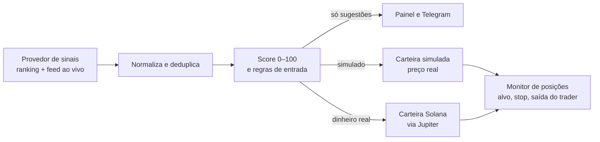

# MNEME

Bot de copy trading. Acompanha os traders do Top de um ranking, avalia cada operação deles com um score de risco explicável e, conforme o modo escolhido, sugere, simula ou executa a mesma compra e venda numa carteira Solana dedicada.

> **Quer colaborar?** Clone numa pasta de caminho curto e rode `bash colaborar/acesso.sh` (Git Bash no Windows). O script pede seu nome e a senha que eu te mandei e abre o código.

> **O código-fonte deste repositório é criptografado** com [git-crypt](https://github.com/AGWA/git-crypt). Ficam abertos este README e a pasta [`docs/`](docs/), com o system design, decisões de segurança e operação. Sem a chave, os demais arquivos aparecem como dados binários.

## Como funciona

1. **Sinais em tempo real:** recebe por WebSocket as compras, vendas e teses dos traders do Top, descarta duplicados e recupera o que passou durante quedas de conexão.
2. **Filtro de atraso:** nada que chegue mais de 10 s depois da operação do trader na blockchain é comprado.
3. **Score explicável (0–100):** posição no ranking, histórico copiando o trader, consenso entre traders, velocidade do sinal, liquidez, se o preço já disparou e convicção. Cada fator aparece no painel com o motivo.
4. **Decisão determinística:** regras de entrada, tamanho e limites testáveis; nenhuma IA decide valor ou assina ordem.
5. **Execução em três modos:** só sugestões, carteira simulada com preços reais, ou dinheiro real.
6. **Saída:** junto com o trader (total ou proporcional), alvo, stop, stop móvel, tempo máximo ou venda manual.
7. **Calibração honesta:** o score não é vendido como probabilidade; o painel mostra a taxa real de acerto por faixa de score.

## Arquitetura

TypeScript num processo só, em camadas de **portas e adaptadores**:

| Camada | Responsabilidade |
|---|---|
| **Domínio** | Regras puras, sem IO: score, políticas de entrada e risco, consenso, calibração, cálculo de resultado |
| **Aplicação** | Casos de uso: sinais (fila serial), execução, monitor de posições, ranking, configurações, painel |
| **Infraestrutura** | Adaptadores: provedor de sinais, dados de mercado, executores (simulado e Solana), arquivos, Telegram |
| **Interface** | Painel web e API, comandos do Telegram |

Trocar a fonte de sinais, o fornecedor de preço ou a rede de execução é escrever um adaptador novo, sem tocar no domínio. Desenho completo, requisitos, fluxos, decisões e falhas: **[docs/system-design.md](docs/system-design.md)**.

## Engenharia

- Testes automatizados do domínio, do fluxo completo e dos adaptadores externos, com formatos reais das respostas.
- Exatamente uma ordem por evento: deduplicação por `eventId` e idempotência na execução, mesmo com replay, reconexão ou reinício.
- Docker com reinício automático, checagem de saúde e acesso ao painel por Cloudflare Tunnel + Access.

## Segurança (blue team)

- **Segredos fora do código:** chaves e endereços de serviços só no ambiente; dinheiro real exige duas chaves de ativação e confirmação explícita.
- **Defesas na execução:** recusa de ordem antes de assinar se a cotação piorar além do limite; reconciliação pela blockchain quando a resposta do agregador se perde; disjuntor que pausa entradas após falhas seguidas.
- **Limites rígidos:** por ordem, por token, exposição total, posições simultâneas e perda diária.
- **Superfície mínima:** painel só em `127.0.0.1` por padrão, senha obrigatória quando exposto, proteção contra requisições de outros sites, Telegram restrito a um chat.
- **Confidencialidade:** git-crypt com tudo fechado por padrão e varredura de sigilo antes de cada commit.

## Documentação

| Documento | Conteúdo |
|---|---|
| [docs/system-design.md](docs/system-design.md) | Requisitos, arquitetura, fluxos, estados, decisões, falhas e evolução |
| [docs/codigo.md](docs/codigo.md) | Pastas, SOLID na prática, robustez e segurança da execução |
| [docs/operacao.md](docs/operacao.md) | Como rodar, modos e roteiro de conexão |
| [docs/deploy.md](docs/deploy.md) | Servidor 24 h, Cloudflare, Telegram e backup |
| [docs/design.md](docs/design.md) | Linguagem visual do painel |
| [docs/criptografia.md](docs/criptografia.md) | Criptografia do repositório e acesso de colaboradores |

## Aviso

Projeto pessoal e de estudo. Não é recomendação de investimento: desempenho passado de um ranking não garante resultado futuro, e operar criptoativos pode causar perdas.

© Thiago Antunes. Todos os direitos reservados.
