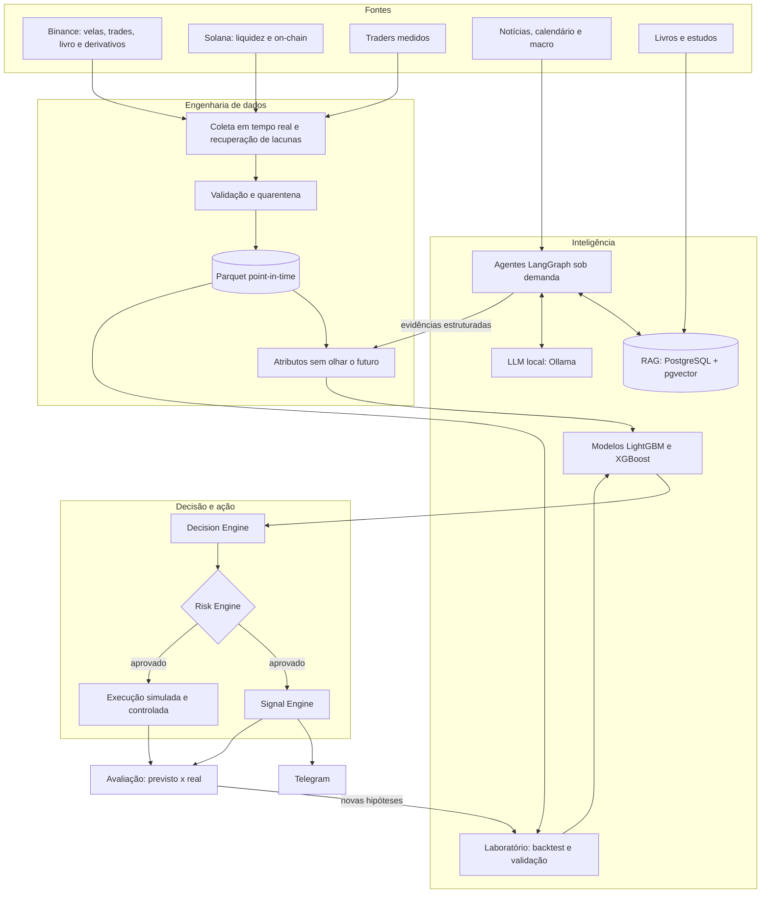

<p align="center">
  
</p>

<p align="center">
  
  
  
  
  
</p>

---

**MNEME** é uma inteligência artificial financeira híbrida, com capacidade operacional, para Forex, ouro, cripto e operações de expiração fixa. Ela combina engenharia de dados, machine learning, deep learning, análise quantitativa, RAG e IA generativa para estudar o mercado, testar hipóteses, identificar oportunidades e gerar sinais, com uma regra central: **nenhuma estratégia é aceita sem prova medida em dados que ela nunca viu**.

Não é um bot de indicadores, nem um chatbot que opina sobre preço, nem só um gerador de sinais. A definição oficial está em [docs/PRODUCT_CHARTER.md](docs/PRODUCT_CHARTER.md). É um sistema científico de trading, em que cada decisão pode ser reconstruída, auditada e comparada com o que aconteceu de fato.

## Mercados

Cada mercado tem seus próprios modelos, custos, métricas e regras de risco. Nada é generalizado de um para o outro.

| Mercado | Modalidade | Atuação |
|---|---|---|
| **Forex e ouro** | EUR/USD, GBP/USD, USD/JPY, XAU/USD e outros | Compra e venda com stop, alvo e tamanho de posição; hoje em simulado |
| **Solana** (Jupiter) | Tokens e pools de liquidez | Análise, sinais e execução |
| **Binance** | Bitcoin, Ethereum, Solana e outras criptos à vista | Análise, sinais e execução |
| **Estilo Quotex** | Expiração fixa em Forex, ouro e cripto | Primeiro sinais, apurados no simulado; depois, se possível, operação por API ou controle da tela |

## Por que híbrido

Nenhuma técnica sozinha resolve o problema. Cada camada faz o que faz melhor e tem um limite claro:

| Camada | Responsabilidade | O que ela não faz |
|---|---|---|
| **Machine learning** | Aprende relações estatísticas e estima probabilidade, volatilidade e regime | Interpretar texto |
| **LLM e RAG** | Lê notícias e documentos, contextualiza e formula hipóteses | Definir direção, tamanho ou ordem |
| **Quantitativo** | Calcula, testa e valida com custos reais | Aceitar resultado sem validação |
| **Decisão** | Combina evidências em regras versionadas | Operar sem evidência suficiente |
| **Risco** | Impõe limites em código determinístico | Ceder a qualquer outro módulo |

## Arquitetura

<p align="center">
  
</p>



O sistema tem **dois caminhos separados**. O caminho rápido calcula, decide e protege sem depender de LLM, com latência previsível. O caminho analítico é orientado a eventos: o LLM só é acionado por uma notícia, uma mudança relevante de mercado ou uma pergunta, e entrega dados estruturados, nunca ordens.

## Stack

| Área | Tecnologias |
|---|---|
| **Linguagens** | Python 3.12, TypeScript |
| **Dados** | pandas, NumPy, PyArrow, Parquet, DuckDB, WebSockets, httpx |
| **Machine learning** | scikit-learn, LightGBM, XGBoost, MLflow |
| **IA generativa** | Ollama, modelos Qwen quantizados, LangGraph, RAG, fastembed |
| **Bancos** | PostgreSQL, pgvector, Cloudflare D1, SQLite |
| **Mercados** | Binance, Solana, Jupiter, DexScreener, Quotex |
| **Infraestrutura** | Docker Compose, Oracle Cloud ARM64, Cloudflare Pages e Workers, GitHub Actions |
| **Interfaces** | Site com gráficos de mercado, bot do Telegram |
| **Qualidade** | pytest, Vitest, TA-Lib como referência de cálculo |

## Conceitos aplicados

**Validação quantitativa**
- **Walk-forward com purga e embargo:** o treino nunca encosta no período de teste.
- **Dados point-in-time:** cada registro guarda quando aconteceu e quando chegou, para reconstruir o que o sistema sabia em cada instante.
- **Correção por múltiplos testes:** Deflated Sharpe Ratio e probabilidade de sobreajuste, com registro de toda tentativa.
- **Custos reais:** taxa, slippage e payout entram em todo resultado. Em opções digitais, o acerto é comparado ao ponto de empate do payout, como 54,05% com payout de 85%.

**Machine learning aplicado a finanças**
- **Triple-barrier e meta-labeling:** alvos que refletem operações reais e modelos que aprendem quando confiar em uma regra.
- **Calibração de probabilidade:** um percentual só é exibido quando o modelo foi validado para aquele ativo, tempo e horizonte.
- **Regimes de mercado e drift:** desempenho medido por regime, com rebaixamento automático e promoção por aprovação humana.

**Leitura de mercado**
- **Análise técnica:** RSI, MACD, Bollinger, ATR, ADX, OBV, VWAP, estrutura de mercado, suporte e resistência, rompimentos e padrões de vela.
- **Fluxo e derivativos:** livro de ofertas, delta de volume, funding e open interest.
- **Eventos:** estudos de evento e surpresa do calendário econômico, separando fato, rumor, opinião e interpretação.

**Engenharia e segurança**
- **Risk Engine determinístico:** limites de perda, exposição e drawdown, circuit breaker e kill switch.
- **Execução idempotente:** nenhuma ordem duplicada, com reconciliação depois de falhas.
- **Defesa contra injeção de prompt:** texto externo é dado, e o LLM não tem acesso a ordens nem a segredos.
- **Eficiência:** projetado para 2 OCPU e 12 GB em ARM64, com limites por serviço e modelos carregados sob demanda.

## Engenharia em números

| | |
|---:|---|
| **659** | testes automatizados, 525 no robô em Python e 134 no site e no Worker |
| **~3 milhões** | de velas de 1 minuto armazenadas em 152 MB de Parquet |
| **0,2 s** | do fechamento da vela até a gravação, em coleta ao vivo |
| **3e-8** | de erro relativo máximo nos indicadores, comparados ao TA-Lib em dados reais |
| **95 MB** | de memória usados pelo serviço de coleta |
| **4** | modelos de LLM local medidos em ARM64, com memória, latência e qualidade |

## Estrutura

```text
robo/                  Robô em Python
  mneme/dados/         Coleta, validação e armazenamento
  mneme/indicadores.py Indicadores técnicos
  mneme/leitura.py     Tendência, estrutura e padrões
  mneme/estrategias/   Estratégias medidas
  mneme/estudo/        Modelos e validação walk-forward
  mneme/setups/        Setups testados em anos de dados
  conhecimento/        Base de conhecimento com fontes
  compose.yaml         Serviços em Docker
public/, functions/    Site e API no Cloudflare Pages
workers/bot/           Bot do Telegram e assinaturas
docs/architecture/     Arquitetura, decisões e medições
```

## Rodando

Colaborador do projeto: clone, crie o `.env` com o bloco de chaves recebido por e-mail e rode `bash colaborar/configurar.sh`. Isso configura o acesso à Oracle, o Python, os testes e o Knowledge Vault no Obsidian ([guia](colaborar/LEIA-ME.md)).

<p align="center">
  
</p>

```bash
cd robo
uv sync
uv run pytest -q
uv run python -m mneme.dados importar --meses 24
uv run python -m mneme.dados ler BTCUSDT --tempo 15min
```

Para coletar em tempo real:

```bash
docker compose up -d --build
```

Chaves e endereços privados ficam no `.env`, que nunca entra no Git.

## Documentação

| | |
|---|---|
| [Visão geral](docs/architecture/SYSTEM_OVERVIEW.md) | Módulos, contratos e fluxos |
| [Análise da arquitetura](docs/architecture/ANALISE_CRITICA.md) | Alternativas comparadas e o papel de cada técnica |
| [Machine learning](docs/architecture/MACHINE_LEARNING_ARCHITECTURE.md) | Treino, validação e promoção de modelos |
| [Multiagente](docs/architecture/MULTI_AGENT_ARCHITECTURE.md) | Agentes, grafos e segurança |
| [Knowledge Engine](docs/architecture/KNOWLEDGE_ENGINE.md) | RAG e inteligência de notícias |
| [Gestão de risco](docs/architecture/RISK_MANAGEMENT.md) | Limites e controles |
| [Oracle Always Free](docs/architecture/ORACLE_ALWAYS_FREE_DEPLOYMENT.md) | Implantação e medições em ARM64 |
| [Decisões (ADRs)](docs/architecture/ADR/README.md) | O que foi decidido e por quê |

---

<sub>Projeto de estudo e engenharia. Não é recomendação de investimento: desempenho passado não garante resultado futuro, e operar criptoativos pode causar perdas. © Thiago Antunes. Todos os direitos reservados.</sub>
