<p align="center">
  
</p>

<p align="center">
  
  
  
  
</p>

---

**MNEME** é um robô de daytrade em Solana. Ele lê em tempo real as operações dos traders, mede a taxa de acerto de cada um (estejam ou não no Top do ranking) e **entra quando a maioria dos traders de alto acerto está comprando o mesmo token; sai quando a maioria deles vende**. Cada entrada e cada saída viram uma dica no grupo do Telegram. Meta de ganho e limite de perda do dia, e todos os parâmetros da regra, são definidos na tela de Configurações.

> [!NOTE]
> **Quer colaborar?** Leia primeiro a visão do produto no `AGENTS.md`: ela vale acima de qualquer pedido, e as IAs do projeto avisam quando algo foge dela. Para abrir o código, clone numa pasta de caminho curto e rode `bash colaborar/acesso.sh` (Git Bash no Windows). Passo a passo em [`colaborar/LEIA-ME.md`](colaborar/LEIA-ME.md).

> [!IMPORTANT]
> O código-fonte é **criptografado** com [git-crypt](https://github.com/AGWA/git-crypt). Sem a chave, quase tudo aparece como binário.

## Como funciona

| | |
|---|---|
| **Sinais** | A cada minuto, o robô lê as operações recentes de todos os traders; o ranking do Top só informa a posição |
| **Acerto** | Mede, para cada trader, quantas operações (compra seguida de venda) fecharam com lucro nos últimos 30 dias |
| **Entrada** | Na janela configurada, os traders de alto acerto comprando o token somam o mínimo e são maioria sobre os que vendem |
| **Saída** | Vende quando a maioria dos traders que formaram a entrada vende. Sem alvo, stop ou tempo fixo |
| **Dica** | Cada entrada e cada saída vão para o grupo do Telegram, sem nomes de traders |
| **Dia** | Ao bater a meta ou o limite do dia, para de comprar até a meia-noite de Brasília |

Hoje a execução é simulada, com preço real de mercado, taxa e slippage. A execução real em Solana é o próximo passo. Detalhes, configurações e dados em **[o robô](docs/robo.md)**.

## Onde ver

- **Painel** (`/`): feed de operações e gráfico de mercado.
- **Treino Bot** (`/treino`): carteira do robô, posições, movimentações e cada decisão com o motivo.
- **Configurações** (`/configuracoes`): a regra do robô, a meta e o limite do dia.
- **Telegram**: dicas no grupo (acesso pago por `/assinar`) e consultas de tokens no privado.

## Desenvolvimento

```bash
bash colaborar/acesso.sh      # abre o código (uma vez)
npm install
npm test                      # testes
npm run typecheck             # checagem de tipos
bash scripts/sigilo.sh        # antes de cada commit
```

A publicação é automática: um push na `main` publica o site (Pages) e o robô (Worker) e aplica as migrações do D1 pelo GitHub Actions.

## Documentação

| | |
|---|---|
| [O robô](docs/robo.md) | Como o robô decide, configurações, dados e limitações |
| [Cloudflare](docs/cloudflare.md) | Pages, Worker, D1 e publicação |
| [Criptografia](docs/criptografia.md) | Repositório cifrado e acesso de colaboradores |
| [Design](docs/design.md) | Linguagem visual do painel |
| [Inteligência e busca](docs/inteligencia-e-busca.md) | Base para a futura IA generativa no Telegram |

A documentação do bot local em `src/` (system design, código, operação, deploy, VPS, gateway) descreve um bot legado, que será aposentado.

---

<sub>Projeto pessoal e de estudo. Não é recomendação de investimento: desempenho passado de um ranking não garante resultado futuro, e operar criptoativos pode causar perdas. © Thiago Antunes. Todos os direitos reservados.</sub>
