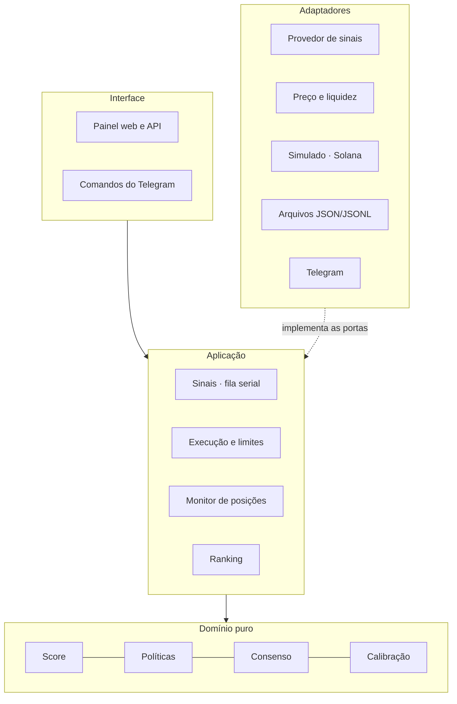

<p align="center">
  
</p>

<p align="center">
  
  
  
  
  
  
</p>

<p align="center">
  <a href="#como-funciona">Como funciona</a> ·
  <a href="#o-score">O score</a> ·
  <a href="#modos">Modos</a> ·
  <a href="#risco-e-limites">Risco</a> ·
  <a href="#arquitetura">Arquitetura</a> ·
  <a href="#seguran%C3%A7a">Segurança</a> ·
  <a href="#come%C3%A7ar">Começar</a> ·
  <a href="docs/system-design.md"><b>System design</b></a>
</p>

---

**MNEME** acompanha os traders do Top de um ranking e, a cada operação deles, decide em segundos se vale copiar. Cada decisão vem com uma nota de 0 a 100 e o motivo por escrito. Conforme o modo, o bot só avisa, opera numa carteira simulada com preços reais ou compra e vende de verdade numa carteira Solana dedicada, sempre dentro de limites rígidos.

> [!NOTE]
> **Quer colaborar?** Clone numa pasta de caminho curto e rode `bash colaborar/acesso.sh` (Git Bash no Windows). O script instala o que faltar, pede seu nome e a senha que eu te mandei e abre o código. Passo a passo em [`colaborar/LEIA-ME.md`](colaborar/LEIA-ME.md).

> [!IMPORTANT]
> O código-fonte é **criptografado** com [git-crypt](https://github.com/AGWA/git-crypt). Ficam abertos este README, a pasta [`docs/`](docs/) e o guia de acesso. Sem a chave, o resto aparece como binário.

## Por que

| Problema de copiar na mão | Como o MNEME resolve |
|---|---|
| Quando você vê a operação, o preço já andou | Sinal por WebSocket e **recusa automática** de tudo que chega mais de 10 s depois do trader |
| "O trader comprou" não diz se vale a pena | **Score de 0 a 100** com sete fatores e o peso de cada um à vista |
| Emoção decide tamanho e saída | **Regras determinísticas**: tamanho, limites, alvo, stop e saída junto com o trader |
| Um erro de rede pode comprar duas vezes | **Exatamente uma ordem por sinal**, mesmo com queda, replay ou reinício |
| Score bonito não quer dizer acerto | **Calibração**: o painel mostra a taxa real de acerto por faixa de score |

## Como funciona

<p align="center">
  
</p>

1. **Sinal.** O provedor de sinais entrega por WebSocket as compras, vendas e teses dos traders do Top. Se a conexão cai, o bot reconecta e busca pelo REST o que passou.
2. **Normaliza.** Valida o formato, descarta repetidos e mede o atraso **desde a transação do trader na blockchain**.
3. **Score.** Busca preço e liquidez do token e calcula a nota de 0 a 100.
4. **Regras.** Aplica atraso máximo, redes permitidas, liquidez mínima, preço já disparado, score mínimo, pausa e limites de risco.
5. **Execução.** Simulada ou em Solana pelo Jupiter, com chave de idempotência e checagem de cotação antes de assinar.
6. **Monitor.** Acompanha o preço e sai no alvo, stop, stop móvel, tempo máximo ou quando o trader vende.

<details>
<summary><b>Orçamento de atraso:</b> de onde vêm os 10 segundos</summary>

| Etapa | Típico |
|---|---|
| Transação do trader até o alerta | ~1 s |
| Rede até o bot | < 0,5 s |
| Preço e liquidez | 0,3–1 s |
| Cotação, assinatura e envio | 1–3 s |
| **Total** | **3–6 s** |

Se o provedor degradar e os alertas chegarem atrasados, o bot **não compra atrasado**: recusa a entrada e continua cuidando das saídas.

</details>

## O score

Uma soma ponderada que **não é probabilidade**. É a ordem de preferência entre sinais; quem diz se "78" acerta muito ou pouco é a calibração medida nas posições encerradas.

| Fator | Peso | Pergunta |
|---|---:|---|
| Histórico copiando o trader | **25** | Quando copiamos esse trader, deu certo? |
| Consenso do Top | **20** | Outros traders do Top compraram o mesmo token há pouco? |
| Posição no ranking | **15** | Quão alto ele está no Top? |
| Liquidez do token | **15** | Dá para entrar e sair sem mexer no preço? |
| Velocidade do sinal | **10** | Quanto tempo passou desde a operação dele? |
| Preço já disparou? | **10** | O token já subiu demais nos últimos 5 min? |
| Convicção do trader | **5** | A compra é maior que o tamanho típico dele? |

Com menos de 5 operações encerradas de um trader, o histórico fica neutro: o bot não inventa confiança.

## Modos

| | Só sugestões | Simulado | Dinheiro real |
|---|:---:|:---:|:---:|
| Mostra o sinal, o score e o motivo | ✔ | ✔ | ✔ |
| Abre e fecha posições | | carteira de mentira, preço real | carteira Solana dedicada |
| Precisa de carteira | | | ✔ |
| Como liga | tela de Configurações | tela de Configurações | `LIVE_TRADING=on` + chave no `.env` + confirmação na tela |

O caminho recomendado é **sugestões → alguns dias no simulado → dinheiro real com US$ 5 a 10 por ordem**.

## Risco e limites

Tudo editável na tela de Configurações e validado no servidor. Valores padrão:

<table>
<tr><th>Entrada</th><th>Tamanho e exposição</th><th>Saída</th></tr>
<tr valign="top"><td>

| | |
|---|---:|
| Score mínimo | 60 |
| Atraso máximo | 10 s |
| Liquidez mínima | US$ 50 mil |
| Alta máxima em 5 min | 30% |
| Redes | Solana |

</td><td>

| | |
|---|---:|
| Por ordem | US$ 25 (5 a 100) |
| Posições abertas | 5 |
| Exposição total | US$ 250 |
| Por token | US$ 100 |
| Perda máxima no dia | US$ 50 |

</td><td>

| | |
|---|---:|
| Alvo | +50% |
| Stop | −20% |
| Tempo máximo | 24 h |
| Junto com o trader | proporcional |
| Slippage entrada / saída | 1,5% / 10% |

</td></tr>
</table>

**Disjuntor:** três ordens falhando em sequência pausam as entradas e avisam no Telegram. A pausa nunca bloqueia saídas.

## Arquitetura

Um processo TypeScript em camadas de **portas e adaptadores**. O domínio não faz IO; a aplicação depende só de interfaces; só a raiz de composição conhece as classes concretas.



Trocar a fonte de sinais, o fornecedor de preço ou a rede de execução é escrever um adaptador novo, sem tocar nas regras. Requisitos, fluxos, estados, decisões e falhas estão no **[system design](docs/system-design.md)**.

<details>
<summary><b>Resiliência:</b> o que acontece quando algo dá errado</summary>

| Falha | Comportamento |
|---|---|
| Feed cai | Reconecta com espera crescente, avisa e recupera o que passou pelo REST |
| Feed conectado mas mudo | Vigia derruba e reconecta após 10 min sem mensagem |
| Mensagem fora do formato | Descartada, registrada e mostrada no painel |
| Cotação pior que o slippage | Ordem recusada antes de assinar |
| Resposta do agregador perdida | Consulta a assinatura na blockchain e reconcilia pelo saldo |
| Venda falha | Tenta de novo com espera de 15 s até 5 min |
| Processo reinicia | Relê o estado; deduplicação e idempotência impedem ordem repetida |

</details>

<details>
<summary><b>Estrutura do repositório</b></summary>

```
src/
  domain/          regras puras: score, políticas, consenso, calibração
  application/     casos de uso e portas
  infrastructure/  adaptadores: sinais, mercado, execução, arquivos, avisos, demo
  interface/       painel HTTP e comandos do Telegram
  config/          variáveis de ambiente
public/            painel e tela de configurações
test/              domínio, fluxo completo, robustez e adaptadores
scripts/           checagens, acessos de colaboradores, sigilo
docs/              system design, código, operação, deploy, design, criptografia
colaborar/         acesso de colaboradores (aberto)
```

</details>

## Segurança

- **Dinheiro real com duas chaves:** `LIVE_TRADING=on` **e** a chave da carteira no `.env`, mais confirmação explícita na tela. Sem elas, o servidor recusa.
- **A chave nunca sai do processo:** a transação é assinada localmente; o agregador recebe só a transação assinada.
- **Carteira dedicada** com pouco saldo e reserva para taxas; venda nunca passa do saldo.
- **Superfície mínima:** painel só em `127.0.0.1` por padrão, senha obrigatória quando exposto, cabeçalho anti-CSRF na API, Telegram restrito a um chat.
- **Segredos fora do git** e auditoria que nunca registra chaves.
- **Código cifrado** com tudo fechado por padrão e acesso individual por senha para colaboradores ([criptografia](docs/criptografia.md)).

## Começar

<p align="center">
  
</p>

```bash
bash colaborar/acesso.sh      # abre o código (uma vez)
npm install
npm run demo                  # dados fictícios, sem chave nenhuma
```

O painel abre em `http://localhost:4740`. Para dados reais, preencha o `.env` a partir do `.env.example` e siga o roteiro de [operação](docs/operacao.md).

| Comando | Para quê |
|---|---|
| `npm run demo` | Painel com feed, ranking e mercado fictícios |
| `npm start` | Bot com dados reais |
| `npm test` · `npm run typecheck` | Testes e checagem de tipos |
| `npm run check:feed` | Confere formato e atraso do provedor de sinais |
| `npm run check:wallet` | Saldo e cotação da carteira, sem enviar transação |
| `npm run telegram:setup` | Descobre o chat e manda uma mensagem de teste |
| `npm run acessos` | Gera os acessos dos colaboradores a partir do `.env` |

**Pelo celular:** `/status`, `/posicoes`, `/pausar`, `/retomar`, `/vender` e `/ajuda` no Telegram.

## Documentação

| | |
|---|---|
| [System design](docs/system-design.md) | Requisitos, arquitetura, fluxos, estados, decisões, falhas e evolução |
| [Código](docs/codigo.md) | Pastas, SOLID na prática, robustez e segurança da execução |
| [Operação](docs/operacao.md) | Como rodar, modos e roteiro de conexão |
| [Deploy](docs/deploy.md) | Servidor 24 h, Cloudflare, Telegram e backup |
| [Inteligência e busca](docs/inteligencia-e-busca.md) | Fontes, enriquecimento de dados e resumos automáticos com IA |
| [Design](docs/design.md) | Linguagem visual do painel |
| [Criptografia](docs/criptografia.md) | Repositório cifrado e acesso de colaboradores |

## Próximos passos

- [x] Domínio, execução simulada e em Solana, painel e Telegram
- [x] Feed real validado: formato, recuperação após queda e atraso desde a blockchain
- [x] Acesso de colaboradores por senha e varredura de sigilo
- [ ] Alguns dias em modo simulado para calibrar o score mínimo
- [ ] Primeiras ordens reais com valores pequenos
- [ ] Servidor 24 h com Docker, Cloudflare e Telegram
- [ ] Executor para redes compatíveis com Ethereum (BSC, Ethereum)

---

<sub>Projeto pessoal e de estudo. Não é recomendação de investimento: desempenho passado de um ranking não garante resultado futuro, e operar criptoativos pode causar perdas. © Thiago Antunes. Todos os direitos reservados.</sub>
