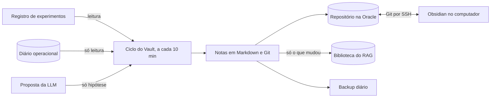

# Knowledge Vault

Camada de conhecimento navegável do MNEME, subordinada ao [Product Charter](PRODUCT_CHARTER.md). O conteúdo fica na Oracle, fora deste repositório público.

O Vault não substitui o RAG nem o banco operacional, e está fora do caminho crítico: o motor não lê nem escreve nele.



## Na Oracle

| Caminho, em `robo/dados/vault/` | Para quê |
|---|---|
| `mneme-knowledge/` | Cópia de trabalho do robô |
| `hub.git/` | Repositório central, acessado só por SSH com chave |
| `backups/` | Pacotes do Vault e cópias da biblioteca, 14 de cada |
| `vault.log`, `cron.log` | Registro de cada nota e de cada ciclo |

O ciclo roda pelo [robo/vault.crontab](../robo/vault.crontab), com prioridade mínima e uma trava contra execuções simultâneas. Nenhuma porta nova é aberta.

## Natureza das notas

Só a tabela de natureza dá crédito a uma nota, e ela é conferida em código.

| Natureza | Peso no RAG | Quem pode declarar |
|---|---|---|
| `referencia-externa`, `conhecimento-tecnico` | Média | Pessoa ou sistema |
| `hipotese`, `nao-verificado` | Baixa | Qualquer um, inclusive a LLM |
| `experimento`, `resultado-em-validacao` | Média | Laboratório ou pessoa |
| `resultado-negativo` | Alta | Laboratório ou pessoa |
| `estrategia-aprovada` | Alta | Só `aprovar_estrategia`, com uma pessoa e os critérios quantitativos |

A aprovação exige pelo menos 1.000 operações, área selada, limite inferior líquido positivo e correção por múltiplos testes. Nota editada à mão que diga mais do que pode vale como `nao-verificado` no RAG e aparece na auditoria.

## No computador dos colaboradores

O computador só visualiza e edita: a Oracle continua operando com ele desligado. Depois de clonar o repositório e criar o `.env`, rode `bash colaborar/configurar.sh` (guia em [colaborar/LEIA-ME.md](../colaborar/LEIA-ME.md)). O Vault fica em `vault/`, ignorada pelo Git, e sincroniza a cada 10 minutos com `hub.git` na A1. No Obsidian, abra essa pasta com **Open folder as vault**.

Conflito: vale a edição feita no computador, e o Git guarda a versão da Oracle no histórico (`git log --full-history`). Se a Oracle estiver fora de alcance, a sincronização espera o próximo ciclo. Backup diário local em `~/.mneme/vault-backups/` (14 pacotes).

## Regras de edição

- Escreva à vontade em **Minhas notas**: o ciclo preserva essa seção.
- Se você editar o corpo de uma nota gerada, o ciclo para de atualizá-la.
- Se o mesmo trecho mudar nos dois lados, vale a sua edição, e o Git guarda as duas versões.
- Se você apagar uma nota que o robô mudou, o ciclo registra o conflito em `vault.log`, sem misturar nada. O robô cria de novo as notas geradas que forem apagadas.

## Comandos na Oracle

```bash
cd ~/mneme/robo && PYTHONPATH=. .venv/bin/python -m mneme.vault buscar "fair value gap"
```

```bash
cd ~/mneme/robo && PYTHONPATH=. .venv/bin/python -m mneme.vault auditar
```

```bash
cd ~/mneme/robo && PYTHONPATH=. .venv/bin/python -m mneme.vault verificar-backup
```

Para restaurar, clone o pacote mais novo de `backups/`:

```bash
git clone backups/vault-AAAAMMDD-HHMMSS.bundle mneme-knowledge
```
