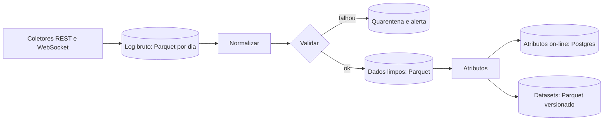

# Market Data Engine

**Situação:** referência de arquitetura, subordinada ao [Product Charter](../PRODUCT_CHARTER.md). O estado real está em [RASTREABILIDADE.md](RASTREABILIDADE.md). A coluna "Testado" registra uma chamada pública feita da A1 em 05/11/2026; resposta 200 mostra que a rota responde, e não que os termos permitem todo uso.

## Regra principal

É preciso conseguir reconstruir **o que o MNEME sabia no momento de cada decisão**. Por isso cada registro leva:

| Campo | Significado |
|---|---|
| `ocorrido_em` | Quando o fato aconteceu, em UTC |
| `recebido_em` | Quando chegou ao MNEME, em UTC |
| `fonte` e `versao_fonte` | De onde veio e em que formato |
| `publicado_em` | Quando a fonte tornou público, se difere do fato |
| `revisao` | Versão do dado, para séries que são revisadas |

Uma consulta "como de T" só devolve dados com `recebido_em <= T`. Em histórico importado, usa-se `publicado_em`, marcando que não foi coletado ao vivo. Séries macro revisadas guardam cada revisão: usar o PIB revisado para decidir na data original é vazamento.

### Notícias RSS

Nos artigos RSS, `publicado_em` é a data declarada pelo feed; ela não prova quando o evento ocorreu. `ocorrido_em` permanece nulo até existir uma fonte que identifique o instante do evento. `recebido_em` registra a primeira leitura do artigo pelo MNEME e é a coluna usada para particionamento, janelas (`inicio`/`fim`) e cortes point-in-time. Itens sem data de publicação ou com data futura são recusados pelo coletor. Registros antigos, particionados originalmente por `ocorrido_em`, continuam legíveis: a consulta filtra pelo `recebido_em` e varre todas as partições legadas.

O `mneme.inteligencia` continua sendo o único ciclo de coleta. Nele, o Hugin determinístico filtra relevância e duplicatas e o Munin anota agrupamentos candidatos; esses rótulos não confirmam a alegação nem a independência das fontes. Veja [NEWS_SOURCES.md](../sources/NEWS_SOURCES.md) para permissões, retenção e feeds habilitados.

## Fontes

| Dado | Fonte | Chave | Testado | Observações |
|---|---|---|---|---|
| Velas | Binance Spot | Não | Sim, em uso | Limites por peso |
| Histórico de velas | `data.binance.vision` | Não | Sim, em uso | Arquivos mensais |
| Trades | Binance `aggTrades` | Não | Sim | Usar WebSocket ao vivo |
| Livro de ofertas | Binance `depth` | Não | Sim | Usar stream ao vivo |
| Funding | Binance Futuros `premiumIndex` | Não | Sim | **Só leitura**; termos a conferir |
| Open interest | Binance Futuros | Não | Sim | **Só leitura** |
| Liquidações | Stream de futuros | A confirmar | Não | Só amostra instantânea, não é o total |
| Traders | Provedor de sinais | Sim, paga | Em uso | Cobra por crédito |
| Tokens Solana | DexScreener | Não | Em uso | 300 req/min, conforme documentação |
| On-chain | RPC, Helius | Conforme plano | Não | Começar no plano grátis |
| Risco de token | GoPlus | A confirmar | Não | Só aviso, nunca garantia |
| Forex histórico | Dukascopy | Não | Não | Termos não confirmados |
| Forex ao vivo | A definir | A definir | Não | A pesquisar |
| Juros, dólar | BCB SGS | Não | Sim | Licença ODbL; máximo de 10 anos por consulta |
| Macro EUA | Órgãos de origem (BEA, Fed; BLS a confirmar) | Não | BEA e Fed sim; BLS 403 no teste | **FRED fica fora do treino**: os termos proíbem esse uso |
| Comunicados | RSS do Fed | Não | Sim | |
| Notícias | GDELT | Não | Limite: 1 a cada 5 s | Recebeu 429 |
| Preço da Quotex | **Nenhuma fonte oficial** | - | Não | Ver abaixo |

### Calendário econômico

É uma fonte de primeira linha: antes de um dado, o sistema pode evitar entradas ou se preparar, e depois mede a **surpresa** contra a expectativa.

| Fonte | Traz | Testado da A1 | Situação |
|---|---|---|---|
| Investing.com | Agenda, previsão, anterior e resultado | **403** | **Não usar de forma automática.** Sem API pública, e [o aviso do site restringe o uso dos dados sem autorização por escrito](https://www.investing.com/about-us/terms-and-conditions). Não se contorna bloqueio. Continua útil para conferência humana |
| Forex Factory (feed semanal em XML) | Moeda, data, hora, impacto, previsão, anterior | Sim: 115 eventos, 70 com previsão | **Candidato principal para consenso, bloqueado até ler os termos**, que não abriram daqui. Sem o resultado no feed semanal |
| Fed (`calendar.json`, FOMC) | Agenda do Fed | Sim | Usar |
| BEA | Agenda de PIB e outros | Sim | Usar |
| BLS | CPI, emprego | 403 no teste | Investigar acesso permitido |
| BCB | Copom | Sim | Usar |
| BCB Focus | Expectativas do mercado no Brasil | Sim | Usar como expectativa local |
| IBGE | IPCA, PIB e outros | Sim | Usar |
| ECB, Eurostat | Agenda da zona do euro | Sim | Usar |
| FRED | Datas de divulgação | Exige chave | **Fora de treino.** Os [termos proíbem uso para desenvolver ou treinar ML](https://fred.stlouisfed.org/legal/terms/) |

Modelo de dados:

```text
evento_calendario(id, fonte, pais, moeda, nome, tipo, impacto, agendado_para,
                  recebido_em, previsao, anterior, resultado, resultado_em, revisao)
```

Cada alteração da agenda vira nova versão, inclusive adiamentos. Como usar:

1. **Antes do evento:** atributo "minutos até o próximo evento de impacto" e, conforme regra medida, bloqueio de entradas na janela.
2. **No evento:** o resultado chega pela fonte oficial, e o sistema calcula `surpresa = resultado - previsao`, padronizada pelo histórico daquele indicador.
3. **Depois:** estudo de eventos mede a reação por tipo e tamanho da surpresa, por exemplo CPI contra EUR/USD e BTC.
4. **Sem consenso permitido:** mede o resultado contra o anterior e a própria reação do mercado, e registra que a medida é mais fraca.

O impacto "alto" informado por terceiros é tratado como ponto de partida. O impacto real é medido.

### O problema da Quotex

Não foi encontrada API oficial, e o pedido exclui automação de navegador e engenharia reversa. Portanto, **a cotação e o payout reais da plataforma não entram automaticamente**. Isso limita a medição, pois os sinais são medidos em outra fonte de preço. Como mitigar:

1. Registrar manualmente uma amostra de cotações e payouts, comparando-os com a referência.
2. Publicar o acerto como "medido na referência", nunca como resultado na plataforma.
3. Ativos "OTC", cuja cotação é criada pela plataforma, ficam fora: não há referência externa para medir.

## Fluxo



| Camada | Tecnologia | Conteúdo |
|---|---|---|
| Bruta | Parquet comprimido | Como veio, para reprocessar |
| Limpa | Parquet + DuckDB | Normalizado, com lacunas marcadas |
| On-line | PostgreSQL | Estado atual, posições, sinais, decisões |
| Conhecimento | PostgreSQL + pgvector | RAG |

## Validação

Aplicada antes de qualquer uso:

- Tempo não pode estar no futuro; ordem e duplicados conferidos.
- Vela coerente: máxima não abaixo de abertura, fechamento e mínima.
- Lacuna é marcada, nunca preenchida em silêncio.
- Preço fora do esperado, comparado a outra fonte quando houver, vai para quarentena.
- **Frescor:** cada fonte tem idade máxima. Dado velho bloqueia entradas pelo Risk Engine.

## Coleta

- Um processo `asyncio` com WebSockets, reconexão com espera crescente e recuperação de lacunas por REST.
- Binance recomenda stream para dados ao vivo; excesso de chamadas REST pode gerar banimento de IP de [2 minutos a 3 dias](https://developers.binance.com/docs/binance-spot-api-docs/websocket-api/rate-limits).
- Um orçamento de créditos para fontes pagas, com aviso e parada ao atingi-lo.
- Filas internas limitadas: em caso de excesso, descarta o livro intermediário e registra a lacuna, sem jamais perder trades e posições.

## Capacidade

São 142 GB livres. Antes de ampliar a coleta, a fase 1 mede o tamanho diário real. Política inicial proposta:

| Dado | Retenção |
|---|---|
| Velas, funding, OI, macro, notícias, decisões, sinais | Para sempre |
| Trades agregados dos pares principais | 1 ano ou até 50 GB |
| Livro bruto | 30 dias |
| Atributos do livro por minuto | Para sempre |

Pares começam em BTC, ETH e SOL, e só crescem depois da medição.

## Backup

Diário, com `pg_dump` e cópia de Parquet para fora da A1, verificado por restauração de teste. O destino gratuito fica a definir, com a cópia para a máquina do dono como opção inicial. Antes de copiar para qualquer serviço de terceiros, os dados são cifrados.

## Atributos

Mesmo código no backtest e na produção, em funções puras que recebem dados "como de T". Um teste exige que o atributo calculado de uma vez sobre o histórico seja igual ao calculado passo a passo, o que detecta olhar para o futuro por engano.

## Migração de SQLite

O `banco.py` já prevê Postgres no servidor. A migração ocorre tabela a tabela, conferindo as contagens, sem perder o placar ao vivo. Velas passam para Parquet, mantendo a consulta recente no Postgres.
