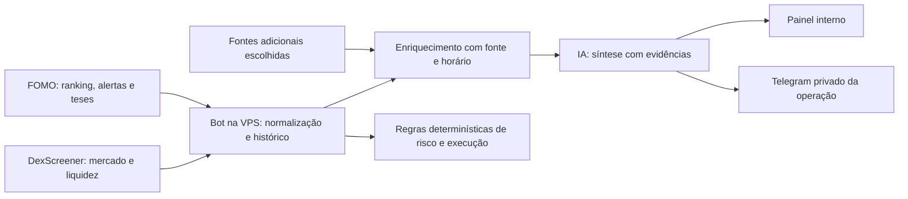

# Inteligência e busca de informações

## Estado atual

O MNEME já recebe eventos e teses do feed FOMO pela VPS, recupera eventos após uma queda, consulta preço/liquidez/variação de 5 minutos no DexScreener e produz score explicável com regras determinísticas. Opcionalmente, `ClaudeThesisAnalyzer` resume teses. Com `THESIS_AI=on`, o resumo agora também é enviado ao chat operacional do Telegram configurado.

O processo de negociação continua na VPS e usa JSON/JSONL como fonte de verdade. O Pages encaminha chamadas do painel à API da VPS. O esquema D1 está pronto para histórico/relatórios, mas ainda não recebe eventos. KV está reservado para cache; o código não o usa. Turso não está integrado. Portanto, criar esses bancos não amplia a busca nem faz a IA enxergar dados automaticamente.

## Fluxo recomendado

O FOMO permanece a fonte dos movimentos dos traders; fontes adicionais complementam o contexto. A IA deve resumir fatos coletados, mostrar fonte e horário e destacar o que não conseguiu verificar. Ela não deve calcular o score, escolher tamanho, executar, pausar ou fechar ordens.

## Próximas melhorias

1. **Busca verificável:** introduzir uma porta `ResearchSource` e adaptadores separados para dados de token/on-chain e notícias. Cada resultado deve guardar URL/origem, horário da fonte, horário da coleta e identificador do token. Não misturar endereços de tokens diferentes só porque o símbolo coincide.
2. **Enriquecimento com limites:** buscar dados somente para tokens que aparecem nos traders acompanhados; usar cache curto com KV quando estiver disponível, respeitar limites dos provedores e continuar o bot quando uma fonte estiver indisponível.
3. **Síntese baseada em evidências:** enviar à IA o evento, os dados recentes e as fontes recuperadas. Pedir resposta estruturada com resumo, fatos a favor, riscos/contrapontos, links e idade dos dados. Tratar textos de terceiros como dados, nunca como instruções.
4. **Entrega útil:** mandar alertas urgentes imediatamente e agrupar contexto de baixa urgência num resumo periódico. Deduplicar por evento/token, limitar frequência e configurar limite de gasto da IA antes de aumentar o volume.
5. **Persistência por função:** manter ordens, posições, configurações e controle operacional na VPS como fonte de verdade; usar D1 para relatórios e histórico replicado; KV para cache descartável; avaliar Turso apenas para conjuntos de dados volumosos que tenham dono e retenção definidos.

As próximas fontes externas devem ser escolhidas após observar quais perguntas ainda ficam sem resposta no painel — por exemplo, concentração de holders, liquidez bloqueada, atividade on-chain ou notícias recentes. Cada provedor exige avaliação de cobertura, atraso, limites, custo e qualidade antes de adicionar credenciais. Não contratar nem conectar um serviço só para preencher a arquitetura.

## Contas e credenciais

- **FOMO:** reutilizar a conta/chave já usada pelo bot na VPS (`SIGNALS_API_KEY`, `SIGNALS_REST_URL`, `SIGNALS_WS_URL`). Nunca colocar esses valores no Pages ou no navegador.
- **IA:** reutilizar a conta Anthropic já compatível com `ClaudeThesisAnalyzer`, usando `ANTHROPIC_API_KEY` apenas no servidor. Configurar orçamento/limites na conta. Começar com resumos de teses; busca web e análise de dados adicionais ficam para depois da escolha de fontes.
- **Telegram interno:** reutilizar o bot e o chat privado de operação configurados por `TELEGRAM_BOT_TOKEN` e `TELEGRAM_CHAT_ID`. A entrega para assinantes precisa de outro fluxo e controles de acesso; não compartilhar o chat administrativo.
- **Cloudflare:** manter Pages/Functions para o painel e proxy, D1 para histórico/relatórios e KV para cache. A chave FOMO, a chave Anthropic e o token do Telegram não pertencem ao bundle público nem ao repositório.
- **Turso:** adiar até haver uma categoria de dados específica que justifique esse banco e um adaptador implementado. Não duplicar ali os mesmos dados operacionais do bot e do D1.

## Ativação do resumo automático atual

Na VPS, no `.env` usado pelo serviço do bot, configure `THESIS_AI=on` e `ANTHROPIC_API_KEY`. Para receber pelo Telegram, o mesmo serviço também precisa de `TELEGRAM_BOT_TOKEN` e `TELEGRAM_CHAT_ID`; `TELEGRAM_MIN_LEVEL` deve permitir mensagens `info` (valor padrão). Reinicie o serviço para carregar as variáveis. O resumo vai para o painel e para esse chat privado; falhas da IA são registradas sem interromper o processamento dos sinais.

O deploy do Pages não liga a IA da VPS e não lê os secrets do `.env`. A configuração da IA deve ficar no ambiente do processo que já coleta o feed.
