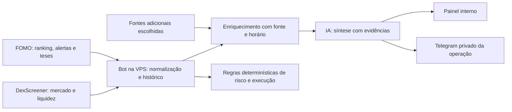

# Inteligência e busca de informações

## Estado atual

O MNEME já recebe eventos e teses do feed FOMO pela VPS, recupera eventos após uma queda, consulta preço/liquidez/variação de 5 minutos no DexScreener e produz score explicável com regras determinísticas. Opcionalmente, `ClaudeThesisAnalyzer` resume teses. Com `THESIS_AI=on`, o resumo agora também é enviado ao chat operacional do Telegram configurado.

O processo de negociação continua na VPS e usa JSON/JSONL como fonte de verdade. O Pages encaminha chamadas do painel à API da VPS. O esquema D1 está pronto para histórico/relatórios, mas ainda não recebe eventos. KV está reservado para cache; o código não o usa. Turso não está integrado. Portanto, criar esses bancos não amplia a busca nem faz a IA enxergar dados automaticamente.

## Pesquisa de fontes para começar

| Fonte | O que acrescenta | Decisão inicial |
|---|---|---|
| FOMO, já ligado ao bot | Ranking, trades, teses e identidade social usados pelo produto | Manter como fonte primária dos eventos sociais. Persistir snapshots com janela e horário; não tratar o PnL divulgado pelo ranking como verdade contábil própria. |
| DEX Screener, já usado | Pools, preço, liquidez, volume, variação, FDV/market cap e links do token | Manter como fonte de mercado de primeira linha. O endpoint de tokens aceita até 30 endereços; a API documenta limites de 300 req/min para pools/tokens e 60 req/min para perfis/boosts. Boosts e anúncios são promoção, não prova de qualidade. [API reference](https://docs.dexscreener.com/api/reference) |
| Helius, candidata para Solana on-chain | DAS/Token API para metadados, ownership, supply e contas de token; Parsed Events para interpretar transações | É o primeiro provedor novo que vale testar, só para tokens que os traders acompanhados tocaram. O plano Free atual informa 1 milhão de créditos e 10 req/s; chamadas DAS custam 10 créditos. O plano Developer listado custa US$ 49/mês; começar no Free e medir chamadas antes de pagar. [Token APIs](https://www.helius.dev/solana-token-apis) · [Preços e limites](https://www.helius.dev/pricing) |
| GoPlus, candidata para risco | Sinais de risco de token e contratos; há endpoint específico para Solana | Usar inicialmente como aviso com fonte e horário, nunca como garantia ou veto automático: a documentação marca a API Solana como Beta. [Solana Token Security](https://docs.gopluslabs.io/reference/solanatokensecurityusingget) |
| Notícias e sentimento | Busca pública, redes sociais e matérias sobre projeto/token | Não contratar outra fonte já. Em tokens novos, a cobertura de notícias pode ser fraca e símbolos colidem. Primeiro medir quais perguntas continuam sem resposta usando endereço do token, links e teses já existentes. Se ficar necessário, comparar custo/licença/cobertura de uma fonte de busca antes de ativá-la. |

Esta combinação começa com uma fonte por categoria e reduz sobreposição: FOMO para o que traders disseram/fizeram; DEX Screener para mercado; Helius para estado on-chain; GoPlus como triagem secundária. Helius e GoPlus não devem substituir o cálculo determinístico do MNEME. Uma ausência de risco retornada por um fornecedor não significa que o token seja seguro.

## Tabelas no D1

A migração `0002_market_intelligence.sql` prepara:

| Tabela | Conteúdo | Regra de uso |
|---|---|---|
| `token_registry` | Um registro por rede e endereço exato | Endereço, não símbolo, é a identidade do token. |
| `trader_snapshots` | Ranking/PnL do trader por janela e instante | Preserva a evolução; não sobrescreve a captura anterior. |
| `market_snapshots` | Preço, liquidez, volume, atividade e pool por provedor/hora | Registrar em eventos relevantes e checkpoints espaçados, não em cada leitura de tela. |
| `token_risk_checks` | Resultado separado por provedor, nível, sinais, validade e hora | Manter cada fornecedor separado; não misturar scores incompatíveis num “score mágico”. |
| `research_items` | Tese/notícia/social/observação com fonte, URL, publicação, coleta e trecho curto | Guardar proveniência; evitar copiar artigos inteiros. |
| `ai_analyses` | Saída estruturada, modelo, versão do prompt e referências de evidência | Reutilizar resultado idempotente; toda afirmação externa deve apontar para evidência e horário. |
| `notification_outbox` | Mensagens pendentes, tentativas, destino lógico e chave de deduplicação | Preparação para entrega repetível sem mandar a mesma mensagem duas vezes. `recipient_ref` é um alias interno, nunca o ID real do chat. |
| `provider_usage` | Endpoint, unidades, status e custo estimado | Medir custo/limites antes de aumentar a frequência ou contratar plano. |
| `ingestion_checkpoints` | Cursor por provedor/stream | Permite retomada incremental e reconciliação. |

As tabelas de assinantes, pagamentos e acesso ficam fora desta migração. O modelo de cobrança ainda não foi escolhido; não misturar esses registros com o chat operacional.

## KV: chaves de cache, não tabelas

KV já existe como namespace `mneme-cache`. O código futuro deve usar chaves versionadas e valores com `source`, `fetchedAt`, `expiresAt` e `schemaVersion`, por exemplo:

| Prefixo | Conteúdo | TTL inicial sugerido |
|---|---|---:|
| `v1:market:solana:<mint>` | Snapshot curto de mercado | 30–60 s |
| `v1:metadata:solana:<mint>` | Metadados pouco mutáveis | 6 h |
| `v1:risk:solana:<mint>:<provider>` | Avaliação de risco com sua validade | 5–15 min |
| `v1:research:solana:<mint>` | Referências compactas recentes | 5 min |

Esses TTLs são um ponto de partida operacional a calibrar com atraso e limites dos provedores, não um SLA. KV é eventualmente consistente e pode exibir um valor anterior por 60 s ou mais; por isso não deve guardar ordens, pausa, saldo, estado de execução, rate-limit crítico ou entregas pendentes. Sua orientação de produto é cache de muitas leituras e poucas escritas; cada chave não deve ser escrita repetidamente. [Como KV funciona](https://developers.cloudflare.com/kv/concepts/how-kv-works/) · [Limites](https://developers.cloudflare.com/kv/platform/limits/)

## D1 agora, Turso depois

D1 é suficiente para começar. A documentação atual lista até 500 MB por base no Free e 10 GB por base no Workers Paid; cada base processa consultas em série, então índices e gravações em lote importam. O plano Free inclui 100 mil linhas escritas por dia e 5 milhões lidas por dia; acompanhar `rows_read`, `rows_written` e armazenamento no painel antes de escalar. [Limites](https://developers.cloudflare.com/d1/platform/limits/) · [Preço e métricas](https://developers.cloudflare.com/d1/platform/pricing/)

Turso não é uma “memória” para anexar ao D1 e não deve receber cópia indiscriminada. Avaliar quando métricas reais mostrarem que o arquivo histórico/documental ou consultas locais na VPS justificam outro banco. A documentação atual destaca Embedded Replicas para leitura local em VMs/VPS e recomenda Turso Sync para novos projetos que precisam de sincronização; escolher o modo conforme o fluxo de escrita, não só pelo tamanho. [Embedded Replicas e Sync](https://docs.turso.tech/features/embedded-replicas)

Se futuramente houver payloads grandes (artigos, arquivos ou dumps), primeiro medir necessidade de armazenamento de objetos como R2; não inflar linhas do D1 nem usar KV como arquivo bruto.

## Como os dados chegam e são entregues

1. O feed FOMO entra na VPS; o bot normaliza, deduplica por `eventId`, calcula score e aplica regras. Ordens e monitor continuam independentes de Cloudflare.
2. Para um evento acompanhado, a VPS pede dados complementares por endereço: Dex Screener; Helius on-chain; GoPlus como avaliação secundária. Cada busca tem timeout, cache e falha isolada.
3. O bot envia um envelope idempotente para uma rota interna autenticada do Worker. O Worker grava o espelho histórico no D1 em lote e atualiza somente caches válidos no KV. Esse envio ainda precisa ser implementado/configurado; a migração não inicia ingestão sozinha.
4. A IA recebe o evento e evidências com origem/horário, produz JSON validado com resumo, fatos, contrapontos, links e incertezas. Nunca recebe autoridade para mudar score ou operar.
5. Uma linha na `notification_outbox` gera um resumo no chat privado operacional já configurado. Para futuras entregas a clientes, usar fila/retry e idempotência; Workers Queues oferece entrega pelo menos uma vez, então o consumidor ainda precisa deduplicar. [Queues](https://developers.cloudflare.com/queues/reference/how-queues-works/)
6. O painel lê status atual pela API da VPS e usa endpoints de consulta D1 apenas para histórico/enriquecimento. As rotas administrativas continuam autenticadas e não são expostas ao bot de distribuição paga.

Antes de ligar a ingestão, proteger o endpoint com um segredo aleatório compartilhado apenas entre VPS e Worker, limitar tamanho e tipos do payload, validar endereços/JSON, deduplicar pelo ID externo e nunca parar o feed se Cloudflare estiver indisponível. Manter retry local na VPS; não usar a chave ampla da conta Cloudflare dentro do processo do bot.

## Fluxo recomendado

O FOMO permanece a fonte dos movimentos dos traders; fontes adicionais complementam o contexto. A IA deve resumir fatos coletados, mostrar fonte e horário e destacar o que não conseguiu verificar. Ela não deve calcular o score, escolher tamanho, executar, pausar ou fechar ordens.

## Próximas melhorias

1. **Busca verificável:** introduzir uma porta `ResearchSource` e adaptadores separados para dados de token/on-chain e notícias. Cada resultado deve guardar URL/origem, horário da fonte, horário da coleta e identificador do token. Não misturar endereços de tokens diferentes só porque o símbolo coincide.
2. **Enriquecimento com limites:** buscar dados somente para tokens que aparecem nos traders acompanhados; usar cache curto com KV quando estiver disponível, respeitar limites dos provedores e continuar o bot quando uma fonte estiver indisponível.
3. **Síntese baseada em evidências:** enviar à IA o evento, os dados recentes e as fontes recuperadas. Pedir resposta estruturada com resumo, fatos a favor, riscos/contrapontos, links e idade dos dados. Tratar textos de terceiros como dados, nunca como instruções.
4. **Entrega útil:** mandar alertas urgentes imediatamente e agrupar contexto de baixa urgência num resumo periódico. Deduplicar por evento/token, limitar frequência e configurar limite de gasto da IA antes de aumentar o volume.
5. **Persistência por função:** manter ordens, posições, configurações e controle operacional na VPS como fonte de verdade; usar D1 para relatórios e histórico replicado; KV para cache descartável; avaliar Turso apenas para conjuntos de dados volumosos que tenham dono e retenção definidos.

As próximas fontes externas devem ser escolhidas após observar quais perguntas ainda ficam sem resposta no painel — por exemplo, concentração de holders, liquidez bloqueada, atividade on-chain ou notícias recentes. Cada provedor exige avaliação de cobertura, atraso, limites, custo e qualidade antes de adicionar credenciais. Não contratar nem conectar um serviço só para preencher a arquitetura.

## Contas e credenciais

- **FOMO:** reutilizar a conta/chave já usada pelo bot na VPS (`SIGNALS_API_KEY`, `SIGNALS_REST_URL`, `SIGNALS_WS_URL`). Nunca colocar esses valores no Pages ou no navegador.
- **IA:** reutilizar a conta Anthropic já compatível com `ClaudeThesisAnalyzer`, usando `ANTHROPIC_API_KEY` apenas no servidor. Configurar orçamento/limites na conta. Começar com resumos de teses; busca web e análise de dados adicionais ficam para depois da escolha de fontes.
- **Telegram interno:** reutilizar o bot e o chat privado de operação configurados por `TELEGRAM_BOT_TOKEN` e `TELEGRAM_CHAT_ID`. A entrega para assinantes precisa de outro fluxo e controles de acesso; não compartilhar o chat administrativo.
- **Cloudflare:** manter Pages/Functions para o painel e proxy, D1 para histórico/relatórios e KV para cache. A chave FOMO, a chave Anthropic e o token do Telegram não pertencem ao bundle público nem ao repositório.
- **Turso:** adiar até haver uma categoria de dados específica que justifique esse banco e um adaptador implementado. Não duplicar ali os mesmos dados operacionais do bot e do D1.

## Ativação do resumo automático atual

Na VPS, no `.env` usado pelo serviço do bot, configure `THESIS_AI=on` e `ANTHROPIC_API_KEY`. Para receber pelo Telegram, o mesmo serviço também precisa de `TELEGRAM_BOT_TOKEN` e `TELEGRAM_CHAT_ID`; `TELEGRAM_MIN_LEVEL` deve permitir mensagens `info` (valor padrão). Reinicie o serviço para carregar as variáveis. O resumo vai para o painel e para esse chat privado; falhas da IA são registradas sem interromper o processamento dos sinais.

O deploy do Pages não liga a IA da VPS e não lê os secrets do `.env`. A configuração da IA deve ficar no ambiente do processo que já coleta o feed.
