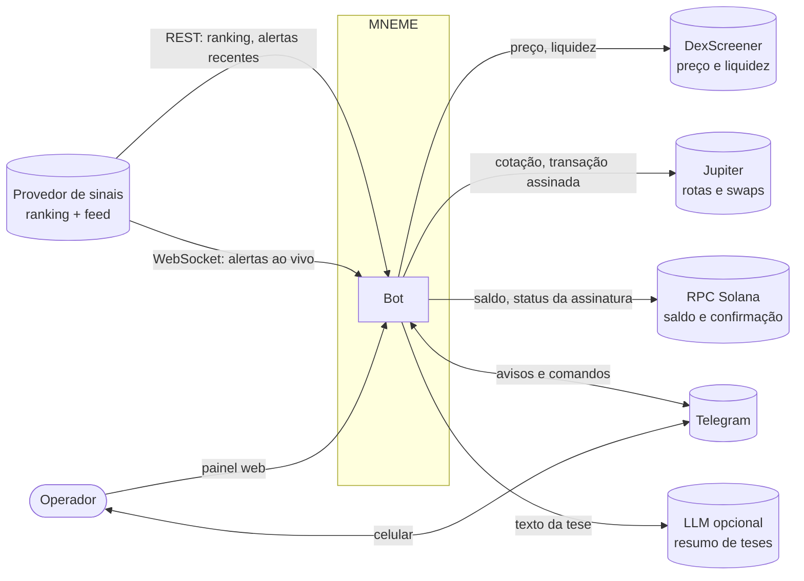
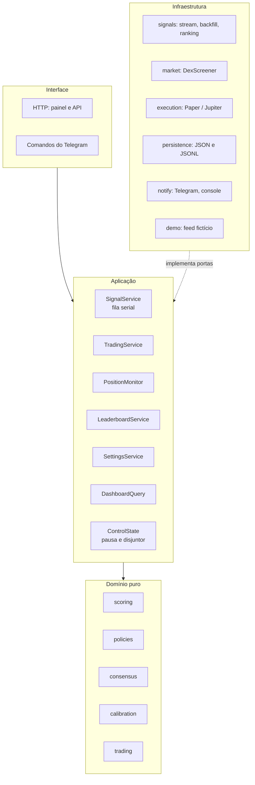
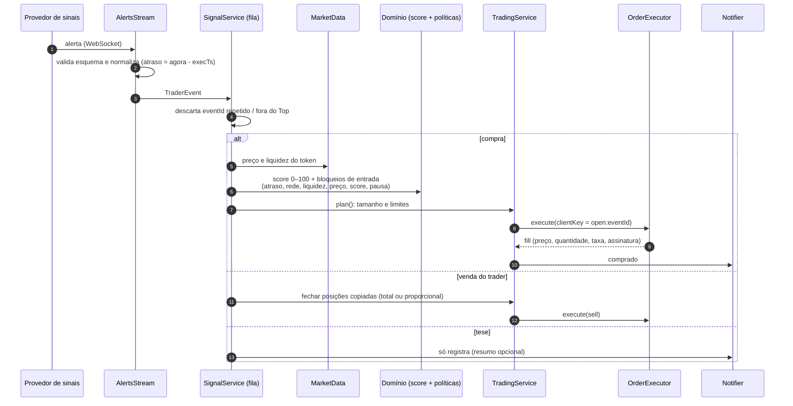
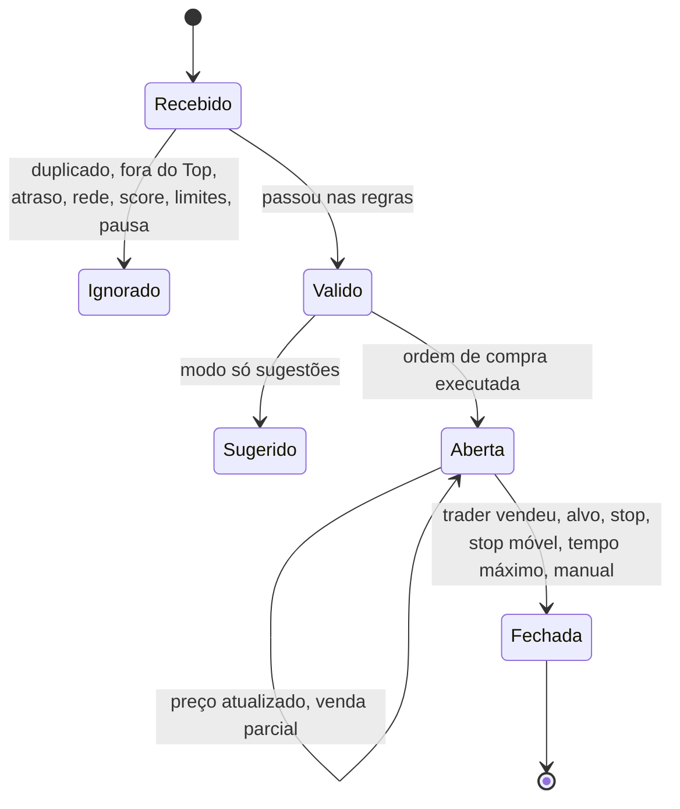

# MNEME: system design

Bot de copy trading: acompanha os traders do Top de um ranking, pontua cada operação deles e, conforme o modo, sugere, simula ou executa a mesma operação numa carteira Solana dedicada.

Este documento descreve **o que o sistema precisa garantir, como ele é montado e por quê**. Detalhes de código ficam em [codigo.md](codigo.md); como rodar, em [operacao.md](operacao.md); servidor, em [deploy.md](deploy.md).

> A origem dos sinais é tratada como um **provedor de sinais** genérico. O sistema não depende de quem é o provedor: ele implementa duas portas (ranking e feed) e pode ser trocado sem mexer no domínio.

---

## 1. Requisitos

### Funcionais

| # | Requisito |
|---|---|
| F1 | Manter o Top N de um ranking (24 h, 7 d, 30 d ou geral) e registrar quem entra e sai. |
| F2 | Receber em tempo real as compras, vendas e teses dos traders, sem duplicar eventos. |
| F3 | Recuperar os eventos perdidos durante uma queda de conexão. |
| F4 | Pontuar cada compra de 0 a 100 com fatores explicados (ranking, histórico, consenso, atraso, liquidez, preço já disparou, convicção). |
| F5 | Decidir entrada, tamanho e limites com regras determinísticas e configuráveis. |
| F6 | Executar em três modos: só sugestões, carteira simulada com preço real, dinheiro real. |
| F7 | Sair junto com o trader (total ou proporcional), por alvo, stop, stop móvel, tempo máximo ou manualmente. |
| F8 | Painel web e Telegram para acompanhar, pausar, retomar e vender. |
| F9 | Medir a taxa real de acerto por faixa de score (calibração). |

### Não funcionais

| Atributo | Meta | Como é atendida |
|---|---|---|
| **Atraso** | Não comprar nada que chegue mais de **10 s** depois da operação do trader | Atraso medido desde a transação na blockchain; sinal mais velho que o limite é recusado antes de qualquer ordem |
| **Exatamente uma vez** | Um evento gera no máximo uma ordem, mesmo com replay, reconexão ou reinício | Deduplicação por `eventId` + chave de idempotência `open:<eventId>` na ordem |
| **Segurança do dinheiro** | Nenhuma ordem real sem intenção explícita; perda limitada | Duas chaves para ligar o modo real, limites por ordem, token, exposição e dia, disjuntor |
| **Disponibilidade** | Bot ligado 24 h; stops executam mesmo com o feed fora | Docker com reinício automático; o monitor de posições não depende do feed |
| **Explicabilidade** | Toda decisão tem motivo legível | Score com fatores e motivos de recusa gravados em cada sinal |
| **Confidencialidade** | Código e fonte de sinais não expostos | git-crypt, endereços só no `.env`, varredura `scripts/sigilo.sh` |
| **Custo** | Operar no plano mais barato do provedor | Ranking com ETag (304 não gasta crédito), atualização a cada 60 min |

### Fora de escopo

- LLM no caminho da ordem: a IA só resume teses, nunca decide valor nem assina.
- Prometer o mesmo preço do trader: atraso, slippage e liquidez mudam o resultado.
- Alavancagem e derivativos.

---

## 2. Visão de contexto

A chave privada da carteira **nunca sai do processo**: a transação é assinada localmente e só a transação assinada vai para o Jupiter.

---

## 3. Arquitetura

Um processo Node.js (TypeScript), em camadas de **portas e adaptadores**. O domínio não faz IO; a aplicação orquestra casos de uso e depende só de interfaces; a infraestrutura implementa as interfaces; `main.ts` é o único lugar que conhece as classes concretas.

### Portas e adaptadores

| Porta | Para quê | Adaptadores |
|---|---|---|
| `LeaderboardSource` | Top N do ranking | REST do provedor, demo |
| `AlertBackfill` | Eventos perdidos numa queda | REST do provedor |
| (stream) | Alertas ao vivo | `AlertsStream` (WebSocket com reconexão e vigia), demo |
| `MarketData` | Preço, liquidez, variação | DexScreener, demo |
| `OrderExecutor` | Comprar e vender | `PaperExecutor`, `JupiterExecutor` |
| Repositórios | Eventos, sinais, ordens, posições, Top, configurações | Arquivos JSON/JSONL |
| `Notifier` | Avisos fora do painel | Telegram, console |
| `ThesisAnalyzer` | Resumo de teses (opcional) | LLM |
| `AuditLog` | Trilha de auditoria sem segredos | JSONL |
| `Clock` | Tempo injetável nos testes | relógio do sistema |

Trocar o provedor de sinais, o fornecedor de preço ou a rede de execução é escrever um adaptador novo. Os serviços e o domínio não mudam.

---

## 4. Fluxo de um sinal

### Orçamento de atraso (meta: até 10 s)

| Etapa | Típico | Observação |
|---|---|---|
| Transação do trader até o alerta do provedor | ~1 s | Medido em alertas reais com captura em tempo real; em modo degradado o provedor pode atrasar dezenas de segundos |
| Rede até o bot | < 0,5 s | Servidor nos EUA ou Europa |
| Mercado (DexScreener) | 0,3–1 s | Uma chamada por token |
| Cotação e envio (Jupiter) | 1–3 s | Inclui assinatura local |
| **Total** | **3–6 s** | Folga para o limite de 10 s |

Quando o provedor degrada, o bot **não compra atrasado**: os sinais são recusados pelo limite, e as saídas continuam.

---

## 5. Estados

Controle global (`ControlState`): **ativo**, **pausado pelo operador** ou **pausado pelo disjuntor** após N falhas seguidas. Pausa bloqueia só entradas; saídas sempre rodam.

---

## 6. Dados e persistência

Tudo em `data/<live|demo>/`, fora do git.

| Arquivo | Tipo | Conteúdo |
|---|---|---|
| `events.jsonl` | só cresce | Eventos normalizados do feed |
| `signals.jsonl` | só cresce (+ atualização) | Decisão, score, motivos |
| `orders.jsonl` | só cresce | Ordens com `clientKey`, fill, assinatura |
| `positions.json` | estado | Posições abertas e fechadas |
| `top.json` / `top-changes.jsonl` | estado / histórico | Top atual e entradas e saídas |
| `settings.json` | estado | Configurações validadas por esquema |
| `audit.jsonl` | só cresce | Conexão, erros, decisões de risco; nunca segredos |

**Por que arquivos e não banco:** um único processo escreve, o volume é pequeno (o feed inteiro tem ~1 alerta/s; o Top 5 opera poucas vezes por hora) e JSONL deixa a auditoria legível e fácil de copiar. A troca por SQLite ou PostgreSQL é só de adaptador, pelas portas de repositório.

---

## 7. Decisões de design

| Decisão | Alternativa descartada | Motivo |
|---|---|---|
| Regras determinísticas no caminho da ordem | LLM decidindo | Previsível, testável, sem custo nem atraso por ordem |
| Fila serial de eventos | Processar em paralelo | Limites de exposição e saldo ficam consistentes sem travas |
| Idempotência por `open:<eventId>` | Confiar na deduplicação do feed | Replay, backfill e reinício não podem comprar duas vezes |
| Atraso desde a transação na blockchain | Desde a publicação do alerta | Mede o que importa: quanto o preço já andou desde o trader |
| Score com fatores ponderados e calibração exibida | Score como "probabilidade" | O painel mostra o acerto real por faixa, sem prometer número |
| Saída com slippage maior que a entrada | Mesmo slippage | Stop precisa executar em queda rápida |
| Endereços do provedor só no `.env` | Valor padrão no código | Sigilo da fonte: o código não revela de onde vêm os sinais |
| Processo único em Docker | Microsserviços e fila externa | Simples de operar numa VPS pequena; nada pede escala horizontal |

---

## 8. Falhas e resiliência

| Falha | Comportamento |
|---|---|
| Feed cai | Reconexão com espera crescente; aviso no Telegram; posições seguem monitoradas |
| Feed conectado mas mudo | Vigia fecha e reconecta após 10 min sem mensagens |
| Eventos perdidos na queda | Backfill pelo REST desde a última mensagem − 60 s; duplicados descartados |
| Provedor degradado (atraso alto) | Sinais acima do limite recusados; nenhuma compra atrasada |
| Mensagem fora do esquema | Descartada, registrada na auditoria e exibida no painel |
| Sem preço do token | Tempo máximo na posição continua valendo |
| Resposta do Jupiter perdida | Assinatura conhecida antes do envio; consulta na rede por 60 s e reconcilia pelo saldo |
| Cotação pior que o slippage | Ordem recusada antes de assinar |
| Venda falha | Nova tentativa com espera de 15 s até 5 min; aviso na terceira falha |
| Falhas seguidas de ordem | Disjuntor pausa entradas; saídas continuam |
| Processo reinicia | Estado relido dos arquivos; deduplicação e idempotência evitam repetir ordens; sem carteira configurada, o modo real volta para simulado |
| Erro inesperado | Registrado e avisado; o processo não cai, porque o monitor precisa seguir |

---

## 9. Segurança

- **Modo real com duas chaves:** `LIVE_TRADING=on` e `SOLANA_PRIVATE_KEY` no `.env`, e confirmação explícita na tela. Sem elas, o servidor recusa.
- **Carteira dedicada** com pouco saldo; 0,02 SOL reservado para taxas; venda nunca passa do saldo.
- **Limites rígidos:** por ordem, por token, exposição total, posições simultâneas e perda diária.
- **Superfície mínima:** painel em `127.0.0.1` por padrão; senha obrigatória quando exposto; escrita na API exige o cabeçalho `x-mneme`; Telegram aceita um chat só.
- **Segredos fora do git:** `.env` ignorado; auditoria e logs nunca recebem chaves.
- **Código cifrado:** git-crypt com tudo fechado por padrão ([criptografia.md](criptografia.md)).

---

## 10. Observabilidade

- **Painel:** status do feed (tempo real ou degradado), atraso típico, Top atual, sinais com motivos, ordens, carteira, acerto por score.
- **`/api/health`:** usado pelo Docker para reiniciar o contêiner.
- **Telegram:** sinais, compras, vendas, queda do feed, falhas, pausas.
- **Auditoria:** `audit.jsonl` com conexão, backfill, mensagens inválidas e decisões de risco.
- **Checagens:** `npm run check:feed` (formato e atraso do provedor) e `npm run check:wallet` (saldo e cotação sem enviar transação).

---

## 11. Capacidade

| Medida | Valor observado |
|---|---|
| Alertas no feed inteiro | ~1 por segundo |
| Alertas do Top 5 | alguns por hora |
| Alertas em Solana | ~50% do feed |
| Custo de CPU e memória | VPS de 1 vCPU e 1 GB sobra |

O gargalo não é o bot: é a liquidez dos tokens copiados e o atraso do provedor.

---

## 12. Evolução

1. **Validar Solana com dinheiro real** em valores pequenos.
2. **Executor EVM** (BSC, Ethereum e redes compatíveis) por um agregador de DEX, implementando `OrderExecutor`. Cobre a maior parte do feed fora da Solana.
3. **Banco de dados** (SQLite ou PostgreSQL) quando o histórico crescer ou houver mais de um processo.
4. **Segundo provedor de sinais** como redundância, juntando os dois feeds pelo `eventId` normalizado.
5. **Métricas** (atraso de ponta a ponta por etapa) para acompanhar o orçamento de 10 s.

Derivativos alavancados ficam fora: o risco é de outra natureza e não combina com copiar memecoins.
